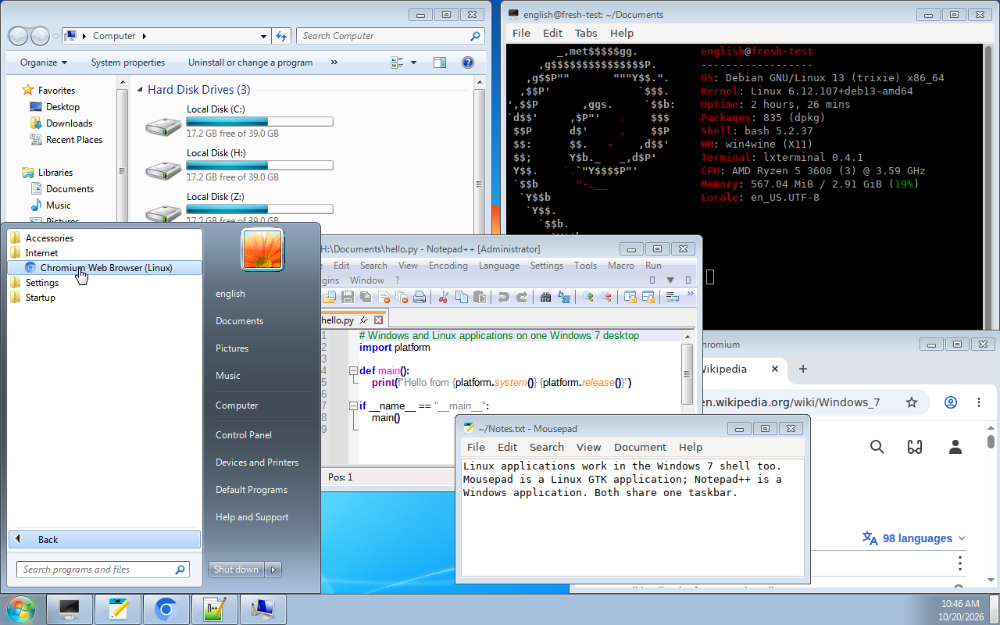
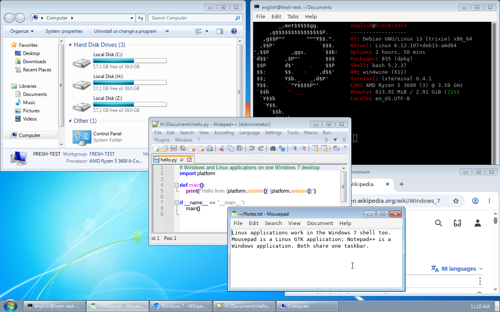
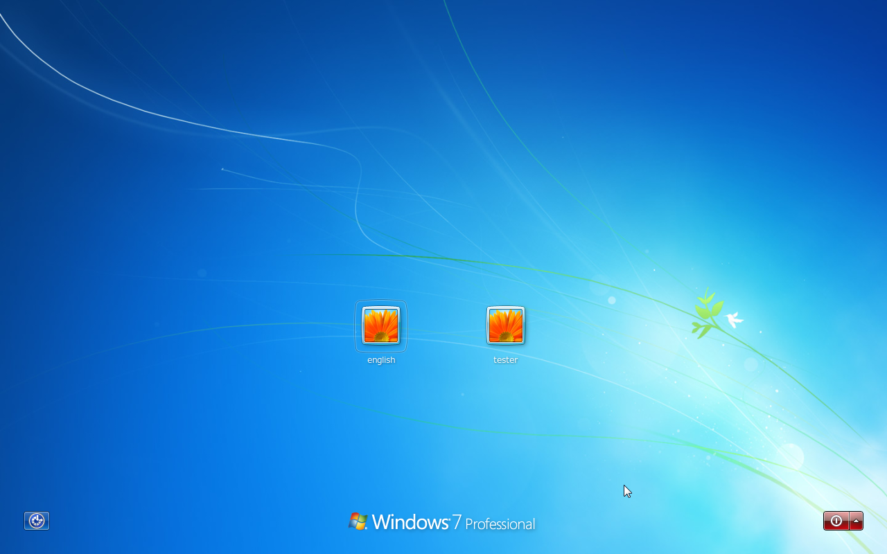

<p align="center">
  
</p>
<p align="center">
  <strong>Your Linux desktop, with the Windows XP shell.</strong>
</p>
<p align="center">
  <a href="../../LICENSE"></a>
  
  
  
</p>
<p align="center">
  <a href="../../README.md">日本語</a> ·
  <strong>English</strong> ·
  <a href="README.zh.md">简体中文</a>
</p>

> [!IMPORTANT]
> **This is a personal, experimental project**, not a finished product for daily use.
> It has only been tested on a **freshly installed Debian 13** set up with the installation script.
> Installing it on a system already in use (with another desktop environment or display manager, for example) has not been tried.
> A virtual machine or a spare machine is recommended.

## Install

1. Get a Windows XP Professional SP3 (x86) ISO (Japanese or English) **yourself**.
2. On a freshly installed Debian 13, run as the user who will log in:

```sh
git clone https://github.com/mikuta0407/win4wine.git ~/win4wine
cd ~/win4wine
scripts/setup.sh --media /path/to/WindowsXPSP3.iso --greeter
```

3. Reboot. The XP Welcome screen logs you straight into the XP shell.

Without an XP ISO, try the ReactOS shell instead (no ISO needed):

```sh
scripts/setup.sh --shell reactos --lang en   # or --lang ja
```

and choose the session "ReactOS Shell (Wine, X11)" at the login screen.

With a Windows 7 SP1 x64 ISO, the Windows 7 shell (experimental) can be set up the same way:

```sh
scripts/setup.sh --shell win7 --media /path/to/Windows7SP1x64.iso
```

and choose the session "Windows 7 Shell (Wine, X11)".

Details: 🔗 [installation guide (INSTALL.en.md)](INSTALL.en.md). Building Wine takes about 90 minutes on 4 cores.
The theme (XP's classic one, for example) and the text size can be changed later ([Changing the look and the text size](INSTALL.en.md#changing-the-look-and-the-text-size)).

## What it is

It runs Windows XP's own `explorer.exe` on a patched Wine as the **desktop shell of Linux**.
The taskbar, Start menu, desktop and folder windows are XP's real ones, and Linux applications get XP's frames and taskbar buttons.

No Microsoft files are included. Only the files that are needed are extracted locally from your own ISO.

Without an XP ISO, the session can run **[ReactOS](https://reactos.org/)'s shell** instead (a Windows 2000-like classic look).
ReactOS is free software, so the setup script downloads it from its official release ([docs/reactos.md](../../docs/reactos.md), Japanese).

With a Windows 7 ISO, it can also run **Windows 7's shell** (the Windows 7 Basic look). It is an experimental prototype
([docs/windows7.md](../../docs/windows7.md), Japanese).

## What it does

- **XP's shell**: Luna (or Classic) taskbar, Start menu, desktop, My Computer and folder windows.
- **Linux applications**: Linux windows get XP's frames; the taskbar, Alt+Tab, minimize and maximize work as on XP.
  Linux applications are listed under All Programs.
- **Notification area**: Linux tray icons (StatusNotifierItem and XEmbed) show up in XP's notification area,
  beside XP's own network, battery and volume icons and their flyouts (Volume, Power Meter, Wireless Network
  Connection Status), fed by NetworkManager and PipeWire or PulseAudio (from XP Explorer in [AshesTom's fork](https://github.com/AshesTom/win4wine)).
  The wireless network list connects to new networks too, through XP's network key dialog. Their menus and windows
  read their words from your ISO's XP files.
- **From XP Explorer**: the folder task pane, Display Properties (the Windows XP and Windows Classic themes, styles and
  color schemes; the schemes are made from your ISO's HIVEDEF.INF and themeui.dll), image thumbnails and previews,
  XP's sounds (startup, logon and logoff too),
  Network Connections, Internet Explorer 6, Windows Media Player 9, and the Start menu's left column (Internet,
  E-mail and the most used programs), all from your own ISO's files (`prefix/extras.py`).
- **Keyboard layout**: the Linux system's (`localectl`) at first. Add input languages or change the default in
  Control Panel, Regional and Language Options, Languages, Details (XP's own), and the session's layout (labwc on
  Wayland, setxkbmap on X11) follows at once; with two or more, Left Alt+Shift switches them as on XP
  (`session/keyboard.py`).
- **Japanese and Chinese input**: fcitx5, with Mozc for Japanese and Pinyin on Simplified Chinese XP; Ctrl+Space (or
  Zenkaku/Hankaku for Japanese) toggles, in GTK, Qt and Wine applications.
- **Japanese, Simplified Chinese or English XP**: any of the ISOs works. The language is detected from the ISO, and the
  fonts (MS UI Gothic on Japanese XP, 宋体 (SimSun) on Simplified Chinese XP, Tahoma and others on English XP), the locale,
  the command prompt's font and the Welcome screen follow that XP (no input method is set up for English XP).
- **Windows applications**: a WoW64 Wine 11.0 runs 32-bit and 64-bit programs. Run `wine setup.exe` in a terminal and
  the installer's shortcuts land in XP's Start menu.
- **XP Welcome screen**: an optional LightDM greeter that shows XP's Welcome and log-off screens.
  While the shell starts, XP's big "welcome" screen is shown.
- **XP's keys**: the Windows key, Ctrl+Esc, Win+R and Win+E.
- **Quick Launch**: right-click the taskbar, Toolbars, Quick Launch (XP and ReactOS; on Windows 7, as on the real one, New
  Toolbar with the Quick Launch folder). Shortcuts to Linux applications from the Start menu can go there too, and Show
  Desktop gives the windows back when used again, as on Windows.
- **Recovery**: if the XP shell keeps crashing, the session falls back to Wine's own explorer and an xterm.
- **Wayland session (optional, even more experimental than the X11 session)**: a patched labwc instead of the X11 WM
  (XP, ReactOS and Windows 7 shells), with a scale per monitor and scales such as 125% or 150%; the shell stays crisp,
  and Wayland applications get the shell's frames too. It is new, tested less than the X11 session and has known limits ([docs/wayland.md](../../docs/wayland.md),
  Japanese). The X11 session is the one to try first.
- **ReactOS shell (optional)**: the session with ReactOS 0.4.16's explorer instead of XP's, in Japanese, Simplified Chinese or
  English; it can be set up beside the XP shell. The desktop's Properties opens a real Display Properties dialog (theme,
  Start menu, DPI, font smoothing), and the Start menu's Accessories folder holds Task Manager, Notepad, Command Prompt,
  Registry Editor, Control Panel and Wine Configuration. The font families the prefix lacks point at its DroidSansFallback,
  so Wine's own windows show Japanese and Chinese instead of boxes.
- **Proton's Direct3D layers**: with Proton's DXVK (Direct3D 9/10/11) and VKD3D-Proton (Direct3D 12) installed into this
  Wine's prefix, games run on Vulkan. A double-clicked `.exe` goes through these layers from the Windows shell and, through
  the MIME handler, from the Linux file manager too (the Wine has to be built with Vulkan).
- **Windows 7 shell (optional, experimental)**: the session with Windows 7 SP1 x64's explorer (the Windows 7 Basic look; no Aero
  glass yet). The Start menu, taskbar, notification area and folder windows work, and Linux applications are grouped per
  application on the taskbar. Tested with Japanese Windows 7, and in English with its strings replaced by the English language pack's.

<table>
  <tr>
    <td align="center" width="50%">
      <br />
      XP's classic theme (<code>--theme classic</code>)
    </td>
    <td align="center" width="50%">
      <br />
      The ReactOS shell (<code>--shell reactos</code>; no XP ISO needed)
    </td>
  </tr>
  <tr>
    <td align="center" width="50%">
      <br />
      The Windows 7 shell (<code>--shell win7</code>; experimental)
    </td>
    <td align="center" width="50%">
      <br />
      The taskbar's "Use small icons" and "Never combine" (applies at once)
    </td>
  </tr>
  <tr>
    <td align="center" colspan="2">
      <br />
      The Windows 7 logon screen (<code>--greeter</code>)
    </td>
  </tr>
</table>

## Caution

> [!WARNING]
> - **Obtain the Windows XP (and Windows 7) ISO yourself.** Neither this repository nor its scripts download any Microsoft files.
>   Follow Microsoft's license terms for the ISO and the files extracted from it.
> - **Use at your own risk.** The author is not responsible for data loss or any other problems.
> - This is an unofficial project, not affiliated with Microsoft or the Wine project.
> - Only the Japanese, the Simplified Chinese and the English XP SP3 (x86) have been tested. XP in other languages is set up the same way as English XP
>   and might work, but it has not been tested at all (`setup.sh` warns and goes on).

## How it works

```text
LightDM ─ XP Welcome greeter (greeter/)
   └─ XP Shell session (session/supervisor.py)
        ├─ Wine 11.0 + 151 patches (wine/patches/)
        │    └─ XP's explorer.exe, shell32.dll, … (extracted from the ISO; ReactOS's or Windows 7's in their sessions)
        ├─ bridge-wm: an X11 WM + Win32 proxy windows (bridge-wm/)
        │    (Wayland session: a patched labwc instead of the WM, wayland/)
        └─ fcitx5 + Mozc, tray bridge (bridge-wm/tray.py)
```

The design documents are in Japanese; [docs/README.md](../../docs/README.md) lists them.

## Similar projects

- [loss32](https://loss32.org/): a planned Linux distribution whose desktop is made only of Win32 software on Wine,
  with parts of ReactOS. While win4wine runs XP's own shell on Debian, loss32 is built from free software only.

## Ground rules

- Binaries from Windows are never modified; differences are handled in Wine and around it.
- Microsoft binaries are never disassembled. Behavior is studied through public APIs and our own probes on a real XP.
- Microsoft files, extracted files and prefixes live only in `localres/` and `.local/`, which Git ignores.

## Contributors

- [AshesTom](https://github.com/AshesTom) ([fork](https://github.com/AshesTom/win4wine)): XP's Display Properties,
  sounds, keyboard layouts, XP's own notification area icons, the Start menu's left column, Internet Explorer 6 and
  Windows Media Player 9, the welcome screen while the shell starts, caption animation and small icons, Arch Linux
  support, `xp.sh` and more.

## License

[LGPL-2.1-or-later](../../LICENSE), the same as Wine. It covers only the code and patches in this repository,
except `wayland/patches/labwc/` (GPL-2.0-only, as labwc) and `wayland/patches/wlroots/` (MIT, as wlroots).
The Windows XP and Windows 7 files, and the XP and Windows 7 screens in the screenshots, are copyrighted by Microsoft.
The ReactOS files that the ReactOS shell uses are under ReactOS's licenses (GPL-2.0-or-later; most of its DLLs LGPL-2.1-or-later).
