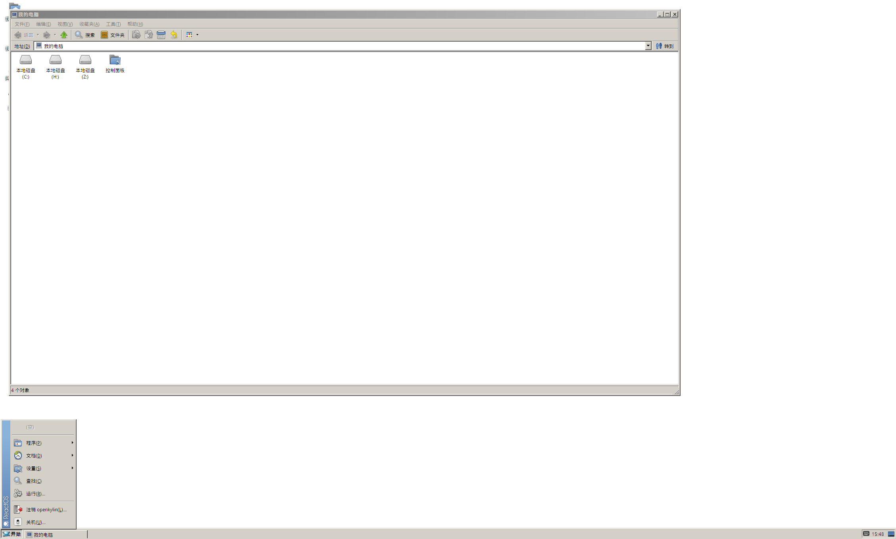

<p align="center">
  
</p>
<p align="center">
  <strong>把 Linux 桌面，换成 Windows XP 的外壳。</strong>
</p>
<p align="center">
  <a href="../../LICENSE"></a>
  
  
  
</p>
<p align="center">
  <a href="../../README.md">日本語</a> ·
  <a href="README.en.md">English</a> ·
  <strong>简体中文</strong>
</p>

> [!IMPORTANT]
> **这是一个个人实验项目**，还没有完成到可以当日常环境使用。
> 目前只在**全新安装的 Debian 13** 上、用安装脚本装好后确认过。
> 在已经使用中的系统上安装（例如已经装了别的桌面环境或显示管理器）没有试过。
> 想试的话，建议用虚拟机或一台试验用的机器。

## 这是什么？

它把 Windows XP 的 `explorer.exe` 跑在打过补丁的 Wine 上，当作 **Linux 的桌面外壳**。
任务栏、开始菜单、桌面、文件夹窗口都是 XP 本尊的；Linux 应用也能套上 XP 的窗口边框、出现在 XP 的任务栏里。

仓库里不包含微软的文件。需要的文件是从你自己手上的 XP ISO 里就地取出来的。

没有 XP ISO 的话，可以改用 **[ReactOS](https://reactos.org/) 的外壳**（Windows 2000 风格的经典外观）来代替 XP 的外壳。
ReactOS 是自由软件，安装脚本会从它的官方发布里下载（[docs/reactos.md](../../docs/reactos.md)，日文）。

## 能做什么

- **XP 的外壳**：Luna（或经典）主题的任务栏、开始菜单、桌面、我的电脑、文件夹窗口。
- **与 Linux 应用集成**：Linux 窗口套上 XP 的边框，任务栏、Alt+Tab、最小化/最大化都和 XP 一样。
  Linux 应用会出现在「所有程序」里。
- **通知区域**：Linux 的托盘图标（StatusNotifierItem 与 XEmbed）显示在 XP 的通知区域里。
- **日文与中文输入**：用 fcitx5，日文用 Mozc，简体中文版 XP 用拼音，Ctrl+Space（日文版也可用全角/半角）切换，
  在 GTK、Qt 和 Wine 的应用里都能用。输入法由会话写进 fcitx5 的配置，装完第一次登录就能用。
- **日文版、简体中文版、英文版的 XP**：三种 ISO 都能用。语言从 ISO 自动判断，字体（英文版是 Tahoma 等，
  简体中文版是宋体/SimSun）、区域设置、命令提示符的字体和欢迎屏幕都跟着那个 XP 走（英文版不配置日文与中文输入）。
- **Windows 应用**：WoW64 的 Wine 11.0 可以跑 32 位和 64 位程序。在终端里 `wine setup.exe`，
  安装程序创建的快捷方式会出现在 XP 的开始菜单里。
- **补齐 XP 外壳缺的部件**：桌面右键的「属性」会打开真正的显示属性对话框（主题、开始菜单、DPI、字体平滑），
  开始菜单的「附件」里放好了任务管理器、记事本、命令提示符、注册表编辑器、控制面板和 Wine 的配置。
  Wine 自己的窗口里中文和日文不会再变成方框：缺的字体族会指向 prefix 里的 DroidSansFallback。
- **Proton 的 Direct3D 翻译层**：把 Proton 里的 DXVK（Direct3D 9/10/11）和 VKD3D-Proton（Direct3D 12）装进这个 Wine 的 prefix，
  游戏就能跑在 Vulkan 上。双击 `.exe` 直接经这层运行——在 Windows 外壳里，以及（通过 MIME 处理器）在 Linux 侧的文件管理器里。
  需要 Wine 是带 Vulkan 编出来的（`libvulkan-dev`）。
- **XP 的欢迎屏幕**：可选，用 LightDM 的 greeter 显示 XP 的欢迎与注销画面。
- **XP 的按键**：Windows 键、Ctrl+Esc、Win+R、Win+E。
- **屏幕放大（DPI）**：和 XP 一样的「DPI 设置」，把文字和部件放大（96、120、144 等）。
- **崩了能回来**：XP 的外壳反复崩溃时，会话会退回到 Wine 自带的 explorer 和 xterm。
- **Wayland 会话（可选，比 X11 会话更实验）**：用打过补丁的 labwc 代替 X11 的窗口管理器，
  支持每台显示器单独缩放以及 125%、150% 这类比例，XP 的外壳不会被拉模糊，Wayland 应用也有 XP 的边框。
  它很新，确认过的范围比 X11 会话小，也有已知限制（[docs/wayland.md](../../docs/wayland.md)，日文）。
  平时想试的话，建议先用 X11 会话。
- **ReactOS 的外壳（可选）**：用 ReactOS 0.4.16 的 explorer 代替 XP 的会话，支持日文、简体中文和英文；
  可以和 XP 的外壳并排装在一起。

<table>
  <tr>
    <td align="center" width="50%">
      <br />
      XP 的经典主题（<code>--theme classic</code>）
    </td>
    <td align="center" width="50%">
      <br />
      ReactOS 的外壳（<code>--shell reactos</code>，不需要 XP 的 ISO）
    </td>
  </tr>
</table>

## 试一下

1. 请**自己**准备 Windows XP Professional SP3（x86）的 ISO（日文版、简体中文版或英文版）。
2. 在全新安装的 Debian 13 上，用将要登录的那个用户执行：

```sh
git clone https://github.com/mikuta0407/win4wine.git ~/win4wine
cd ~/win4wine
scripts/setup.sh --media /path/to/WindowsXPSP3.iso --greeter
```

3. 重启后，从 XP 的欢迎屏幕直接进入 XP 的外壳。

没有 XP 的 ISO 时，可以用 ReactOS 的外壳（不需要 ISO）：

```sh
scripts/setup.sh --shell reactos --lang zh   # 日文用 --lang ja，英文用 --lang en
```

然后在登录界面选择会话「ReactOS Shell (Wine, X11)」。

详细步骤与各种选项在安装指南里（[简体中文](INSTALL.zh.md) / [英文](INSTALL.en.md) / [日文](../../INSTALL.md)）。因为要从源码编译 Wine，
4 核大约需要一个半小时。主题（例如 XP 的经典主题）和文字大小以后都能改。

## 注意

> [!WARNING]
> - **Windows XP 的 ISO 请自己获取。** 这个仓库和安装脚本都不会去下载微软的文件。
>   ISO 以及从中取出的文件，请按微软的许可条款使用。
> - **使用请自担风险。** 数据丢失或其他问题，作者不承担责任。
> - 这是与微软、与 Wine 项目都没有关系的非官方项目。
> - 只确认过日文版和英文版的 XP SP3（x86）。其他语言的 XP 会按英文版同样的方式安装，也许能用，
>   但完全没有试过（`setup.sh` 会给出警告后继续）。
> - **简体中文版 XP 的支持是新加的，还没有在中文版 ISO 上确认过。** 语言判断、字体（宋体/SimSun）、
>   区域设置（`zh_CN.UTF-8`）、命令提示符的字体（新宋体 8×16）和中文输入（fcitx5 + 拼音）都已经就绪，
>   但其中有些值取自 XP 的已知默认值，而不是在中文参考机上量出来的。中文外壳本身用 ReactOS 的路径确认过
>   （对话框里的中文、字体方框的修复、双击运行等，见 [安装指南的「简体中文版 XP」](INSTALL.zh.md#简体中文版-xp)）。
>   繁体中文版（0x0404）会按英文版安装（它的字体和控制台字体都不同，照原样不能直接使用）。

## 工作原理

```text
LightDM ─ XP 的欢迎屏幕（greeter/）
   └─ XP Shell 会话（session/supervisor.py）
        ├─ Wine 11.0 + 77 个补丁（wine/patches/）
        │    └─ XP 的 explorer.exe、shell32.dll……（从 ISO 取出）
        ├─ bridge-wm：X11 窗口管理器 + Win32 代理窗口（bridge-wm/）
        │    （Wayland 会话里用打过补丁的 labwc 代替窗口管理器，wayland/）
        └─ fcitx5（日文用 Mozc，简体中文用拼音）、托盘桥（bridge-wm/tray.py）
```

设计与实现的详细说明在 [docs/](../../docs/README.md) 里（日文），另有一份[中文摘要](../../docs/README.zh.md)（覆盖全部设计文档）。

## 类似的项目

- [loss32](https://loss32.org/)：计划只用在 Wine 上运行的 Win32 软件来搭桌面，并用到 ReactOS 的一部分。
  win4wine 是在 Debian 上跑 XP 本尊的外壳，loss32 则是只用自由软件来搭。

## 坚持的原则

- 不改动 Windows 来的二进制文件。差异都在 Wine 及其周边吸收。
- 不反汇编微软的二进制文件。行为通过公开 API 和跑在真实 XP 上的自制探针来确认。
- 微软的文件、取出的文件、Wine 的 prefix，只放在 Git 不管的 `localres/` 和 `.local/` 里。

## 许可证

[LGPL-2.1-or-later](../../LICENSE)（与 Wine 相同），只覆盖本仓库的代码和补丁。
不过 `wayland/patches/labwc/` 与 labwc 同样为 GPL-2.0-only，`wayland/patches/wlroots/` 与 wlroots 同样为 MIT。
Windows XP 的文件，以及截图里 XP 画面的版权属于微软。
ReactOS 外壳用到的 ReactOS 文件按 ReactOS 的许可证（GPL-2.0-or-later，其中多数 DLL 为 LGPL-2.1-or-later）。
